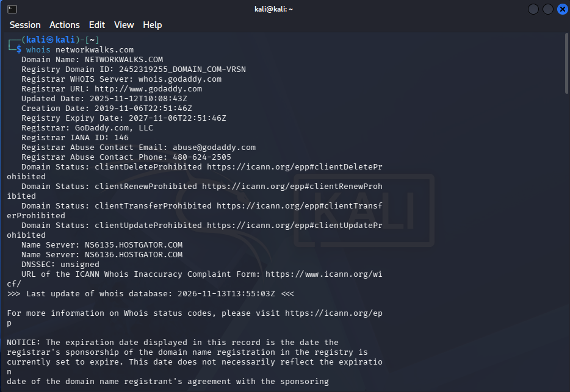
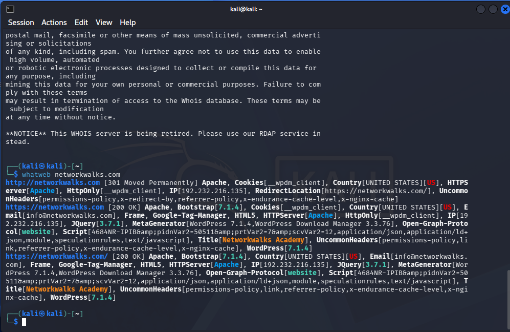
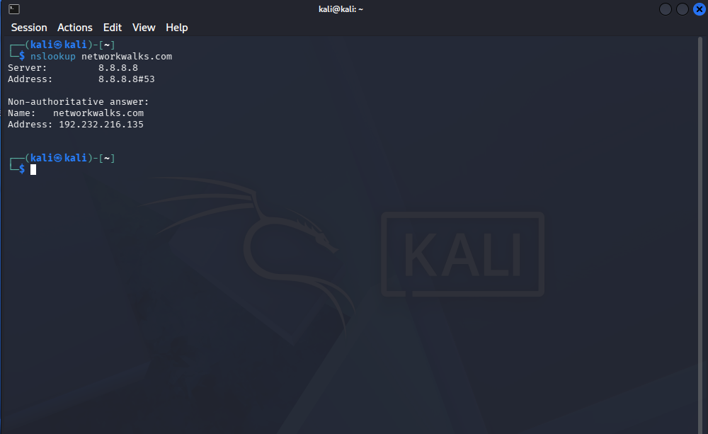
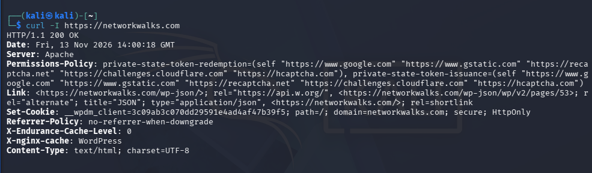
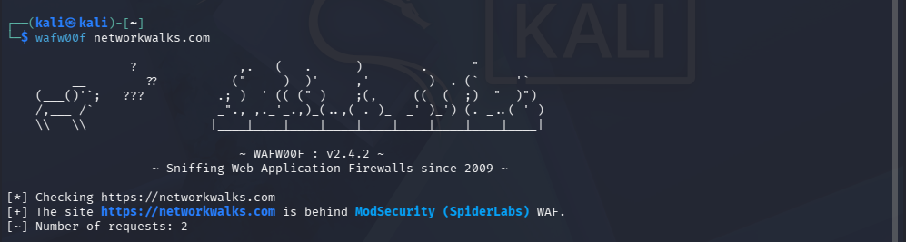
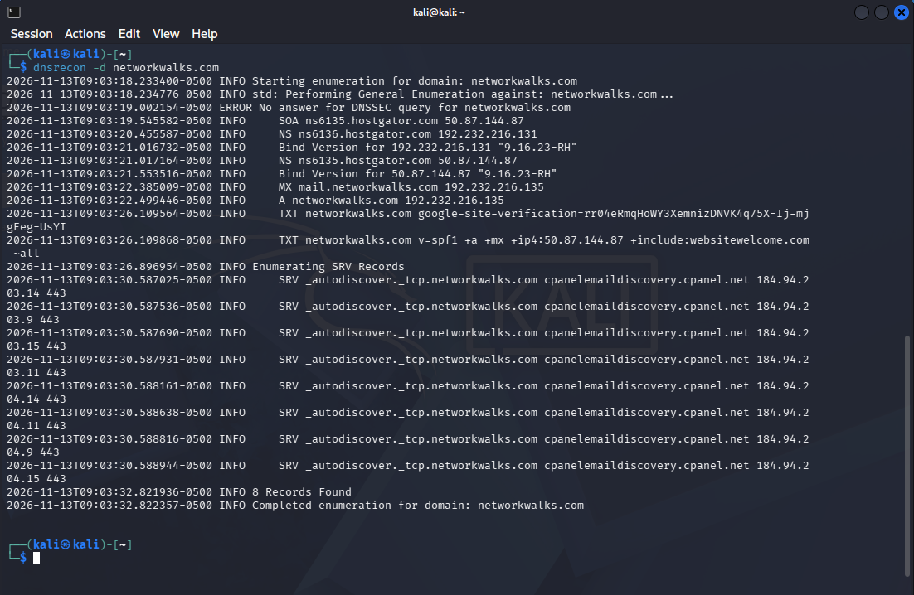

# Week 2 | Project Module 1: Footprinting & Reconnaissance

This repository contains documentation, command outputs, evidence screenshots, and lab reports for the **Footprinting & Reconnaissance Attacks with Multiple Kali Tools** lab from NetworkWalks[cite: 1, 2].

## Objective
To perform passive and active reconnaissance on the target website (`networkwalks.com`) using built-in Kali Linux utilities to gather public intelligence, identify underlying technologies, detect security defenses, and map out the DNS infrastructure before any security assessment[cite: 2].

---

## Lab Report & Documentation
* 📄 **[Download / View Zenmap & Reconnaissance Report (PDF)](Zenmap.pdf)**

---

## Tools & Executed Tasks

### Task 1: Domain Registration Intelligence (`whois`)
* **Command:** `whois networkwalks.com`[cite: 3]
* **Purpose:** Queries public domain registration records to identify ownership, creation/expiry dates, registrar details, and designated name servers[cite: 3].
* **Findings:** 
  * **Registrar:** GoDaddy.com, LLC[cite: 3]
  * **Name Servers:** `ns6135.hostgator.com`, `ns6136.hostgator.com`[cite: 3] (indicating HostGator hosting infrastructure[cite: 3]).
* **Screenshot:**

---

### Task 2: Web Technology Fingerprinting (`whatweb`)
* **Command:** `whatweb networkwalks.com`[cite: 4]
* **Purpose:** Identifies the web server software, Content Management System (CMS), frameworks, plugins, and server IP address[cite: 4].
* **Findings:**
  * **Server & IP:** Apache web server running on IP `192.232.216.135`[cite: 4].
  * **CMS & Plugins:** WordPress 7.0.4 with WordPress Download Manager 3.3.58[cite: 4].
  * **Frameworks & Libraries:** Bootstrap 7.0.4, jQuery 3.7.1[cite: 4].
* **Screenshot:**

---

### Task 3: DNS Resolution (`nslookup`)
* **Command:** `nslookup networkwalks.com`[cite: 5]
* **Purpose:** Resolves the target domain name to its direct IPv4 address[cite: 5].
* **Findings:**
  * **Resolved IP:** `192.232.216.135`[cite: 5].
* **Screenshot:**

---

### Task 4: HTTP Response Header Analysis (`curl`)
* **Command:** `curl -I https://networkwalks.com`[cite: 7]
* **Purpose:** Fetches HTTP response headers to inspect server banners, cookies, redirect rules, and hidden structural endpoints[cite: 7].
* **Findings:**
  * Confirmed Apache server and exposed WordPress REST API endpoint (`/wp-json/`)[cite: 7].
* **Screenshot:**

---

### Task 5: Web Application Firewall Detection (`wafw00f`)
* **Command:** `wafw00f networkwalks.com`[cite: 8]
* **Purpose:** Detects whether a Web Application Firewall (WAF) is protecting the target web application[cite: 8].
* **Findings:**
  * **WAF Detected:** ModSecurity (SpiderLabs)[cite: 8].
* **Screenshot:**

---

### Task 6: Comprehensive DNS Enumeration (`dnsrecon`)
* **Command:** `dnsrecon -d networkwalks.com`[cite: 9]
* **Purpose:** Enumerates complete DNS records including SOA, NS, MX, A, TXT (SPF/site verification), and service (SRV) records[cite: 9].
* **Findings:**
  * Identified mail exchange (`mail.networkwalks.com`), Bind DNS server versions (`9.16.23-RH`), SPF configuration records, and cPanel autodiscover endpoints[cite: 9].
* **Screenshot:**

---

## Summary & Disclaimer
> **Educational Purpose Only:** All activities documented in this repository were conducted strictly for educational and research purposes within authorized lab environments as part of ethical hacking training[cite: 10]. Reconnaissance tools only read publicly available data, making them hard to detect while forming the crucial foundation for security assessment and defense[cite: 10].
